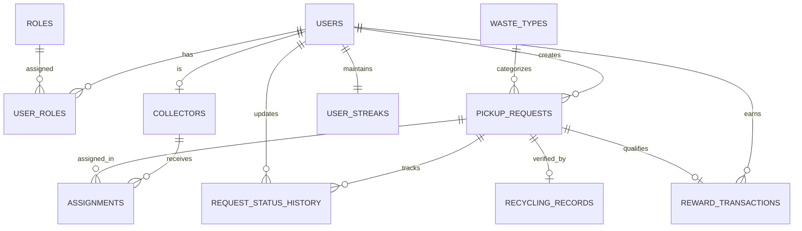

# 🌿 Eco-Tracker
### Smart E-Waste & Dry-Waste Collection Management System

[](https://www.oracle.com/java/)
[](https://spring.io/projects/spring-boot)
[](https://www.mysql.com/)
[-red.svg)](https://spring.io/projects/spring-security)
[](https://getbootstrap.com/)

---

## 📌 Executive Summary

**Eco-Tracker** is a modern full-stack web application designed to connect citizens who want to dispose of electronic waste (e-waste) and dry recyclable waste responsibly with certified field collectors, waste management administrators, and licensed recycling facilities.

Citizens submit pickup requests, administrators review and dispatch verified collectors, collectors record doorstep collections, and the system issues verifiable recycling records alongside an **idempotent eco-reward points and daily streak system**.

---

## 🏗️ Architecture & Technology Stack

The application follows a clean **modular monolith** architectural pattern with strict separation of concerns across Controller, Service, Repository, Entity, and DTO layers.

```text
Browser (Responsive HTML5 / CSS3 / Bootstrap 5 / JavaScript)
      │
      │ HTTP / REST APIs / Thymeleaf Server-Side Rendering
      ▼
Spring Web Controllers (Thymeleaf Web Controllers + /api/v1 REST Controllers)
      │
      ▼
Spring Security Layer (RBAC: ROLE_USER, ROLE_ADMIN, ROLE_COLLECTOR, BCrypt)
      │
      ▼
Service Layer (Business Logic, Idempotent Rewards, Streak Tracking, Audit Trail)
      │
      ▼
Repository Layer (Spring Data JPA + Hibernate ORM)
      │
      ▼
Persistence: MySQL 8.x (Production) / In-Memory H2 (Instant Local Dev & Tests)
```

### Technology Highlights
- **Language:** Java 21 LTS
- **Framework:** Spring Boot 3.3.5
- **Security:** Spring Security 6 with BCrypt password hashing and role-based access control (RBAC)
- **Database:** MySQL 8.x with Spring Data JPA and Hibernate ORM
- **Testing:** JUnit 5, Mockito, Spring Boot Test, Spring Security Test, MockMvc
- **Frontend:** Thymeleaf template engine, Bootstrap 5.3, FontAwesome 6 icons, custom responsive CSS/JS

---

## 👥 User Roles & Demo Credentials

The application comes pre-configured with demo accounts across all three system roles:

| Role | Email | Password | Access & Capabilities |
| :--- | :--- | :--- | :--- |
| **Administrator** | `admin@ecotracker.com` | `Admin@123` | Review all requests, filter by status/category, approve/reject requests with reasons, assign collectors, confirm recycling receipts, view system analytics. |
| **Collector** | `collector@ecotracker.com` | `Collector@123` | Assigned to *Metro North & Central Zone*. Views assigned pickups, schedules, customer contact details, and records doorstep collection outcomes. |
| **Citizen (User)** | `user@ecotracker.com` | `User@123` | Books pickups, tracks status timeline, cancels pending requests, tracks points ledger and recycling streak. |
| **Citizen (User 2)**| `jane@ecotracker.com` | `User@123` | Additional user account for testing ownership isolation and separate request queues. |

> **Tip:** The login page (`/login`) includes **1-click quick fill buttons** to instantly load these credentials for rapid demonstration.

---

## 📊 Database Schema & Relationships

The database schema is fully normalized and follows the design specifications outlined in the project blueprint:



- **DDL File:** [`database/schema.sql`](database/schema.sql)
- **Sample Data File:** [`database/sample-data.sql`](database/sample-data.sql)
- **Architecture Documentation:** [`docs/database-design.md`](docs/database-design.md)

---

## 🔄 Request Lifecycle & Business Rules

```text
               ┌─────────────┐
               │   PENDING   │ ◄── Submitted by User
               └──────┬──────┘
         ┌────────────┼────────────┐
         │ (Approve)  │ (Reject)   │ (Cancel)
         ▼            ▼            ▼
   ┌──────────┐ ┌──────────┐ ┌───────────┐
   │ APPROVED │ │ REJECTED │ │ CANCELLED │
   └─────┬────┘ └──────────┘ └───────────┘
         │ (Assign Collector)
         ▼
   ┌──────────┐
   │ ASSIGNED │
   └─────┬────┘
         │ (Collector Field Pickup)
         ▼
  ┌───────────┐
  │ PICKED_UP │
  └──────┬────┘
         │ (Admin Confirms Recycling Center Receipt)
         ▼
  ┌───────────┐
  │ COMPLETED │ ──► Idempotent Reward Points & Streak Issued
  └───────────┘
```

1. **Ownership Isolation:** Regular citizens can view and cancel only their own pickup requests.
2. **Collector Isolation:** Field collectors can only view and update requests assigned to their collector ID.
3. **Audit Trail:** Every transition creates an immutable record in `request_status_history` logging the user, old status, new status, timestamp, and notes.
4. **Idempotent Rewards:** `reward_transactions.request_id` has a database `UNIQUE` constraint, guaranteeing that repeating completion never issues duplicate points.
5. **Reward Rules:**
   - **E-Waste:** 50 base points + 10 points per kg/unit
   - **Dry-Waste:** 20 base points + 5 points per kg/unit
   - **Streak Bonus:** +15 bonus points when maintaining consecutive recycling days

---

## 🚀 Getting Started

### Prerequisites
- **Java 21 LTS** (or compatible JDK 21-25)
- **Maven 3.8+** (or use the included `mvnw.cmd` / `mvnw` wrapper)
- *(Optional)* **MySQL 8.x** (an embedded H2 profile is configured for zero-setup execution out of the box)

---

### Option A: Instant Run with Default Profile (Zero-Config H2)
The application is pre-configured with a local profile that creates an in-memory MySQL-compatible database and auto-seeds demo data upon launch:

```bash
# Windows
.\mvnw.cmd spring-boot:run

# Linux / macOS
./mvnw spring-boot:run
```

Once started, open your browser:
- **Application URL:** [http://localhost:8080](http://localhost:8080)
- **H2 Web Console:** [http://localhost:8080/h2-console](http://localhost:8080/h2-console)
  - JDBC URL: `jdbc:h2:mem:eco_tracker`
  - User: `sa`
  - Password: *(leave blank)*

---

### Option B: Running with MySQL 8.x

1. **Create the database in MySQL Workbench or CLI:**
   ```sql
   CREATE DATABASE eco_tracker CHARACTER SET utf8mb4 COLLATE utf8mb4_unicode_ci;
   CREATE USER 'eco_app'@'localhost' IDENTIFIED BY 'CHANGE_THIS_LOCAL_PASSWORD';
   GRANT ALL PRIVILEGES ON eco_tracker.* TO 'eco_app'@'localhost';
   FLUSH PRIVILEGES;
   ```
2. *(Optional)* Import the schema and seed data:
   ```bash
   mysql -u eco_app -p eco_tracker < database/schema.sql
   mysql -u eco_app -p eco_tracker < database/sample-data.sql
   ```
3. **Start the application with the MySQL profile:**
   ```bash
   # Windows PowerShell
   $env:SPRING_PROFILES_ACTIVE="mysql"
   $env:DB_URL="jdbc:mysql://localhost:3306/eco_tracker?useSSL=false&allowPublicKeyRetrieval=true&serverTimezone=UTC"
   $env:DB_USERNAME="eco_app"
   $env:DB_PASSWORD="CHANGE_THIS_LOCAL_PASSWORD"
   .\mvnw.cmd spring-boot:run
   ```

---

## 🧪 Running Automated Tests

All business rules, status lifecycles, reward calculations, and access authorizations are thoroughly tested:

```bash
# Run all unit and integration tests
.\mvnw.cmd test
```

### Test Suite Summary
- `RewardServiceTest`: Verifies base points, weight calculations, streak bonuses, and idempotency guarantees.
- `PickupRequestServiceTest`: Verifies service hour constraints (08:00 - 19:00), future date checks, ownership security checks, and cancellation policies.
- `AdminAndCollectorWorkflowTest`: Verifies approval, rejection with reasons, collector dispatch, assigned-only collection confirmations, and prevents unauthorized status jumps (e.g., PENDING directly to COMPLETED).
- `PickupRequestRestControllerTest`: MockMvc tests validating Bean Validation errors (HTTP 400), payload structures, and authorization guards.

---

## 🌐 REST API Documentation

All REST APIs reside under the `/api/v1` base path and accept/return JSON:

| Method | Endpoint | Access Role | Description |
| :--- | :--- | :--- | :--- |
| `POST` | `/api/v1/auth/register` | Public | Register new citizen account (defaults to `ROLE_USER`) |
| `POST` | `/api/v1/auth/login` | Public | Authenticate user and establish session |
| `POST` | `/api/v1/auth/logout` | Authenticated | Terminate session |
| `GET` | `/api/v1/users/me` | User / Admin | Retrieve current profile, roles, streak info |
| `GET` | `/api/v1/pickup-requests` | User / Admin | User sees own requests; Admin sees all requests |
| `POST` | `/api/v1/pickup-requests` | User | Create a new pickup request |
| `GET` | `/api/v1/pickup-requests/{id}` | Owner / Admin / Collector | Get authorized request details |
| `PATCH` | `/api/v1/pickup-requests/{id}/cancel` | Owner / Admin | Cancel request (if in `PENDING` or `APPROVED`) |
| `PATCH` | `/api/v1/admin/requests/{id}/approve` | Admin | Approve pending pickup request |
| `PATCH` | `/api/v1/admin/requests/{id}/reject` | Admin | Reject request (requires reason) |
| `POST` | `/api/v1/admin/requests/{id}/assign` | Admin | Dispatch active collector to request |
| `POST` | `/api/v1/admin/requests/{id}/complete` | Admin | Confirm recycling center receipt & issue rewards |
| `GET` | `/api/v1/admin/summary` | Admin | Summary counts of requests, users, collectors |
| `GET` | `/api/v1/collector/assignments` | Collector | Retrieve active assignments for logged-in collector |
| `POST` | `/api/v1/collector/requests/{id}/pickup` | Assigned Collector | Confirm doorstep pickup outcome |
| `GET` | `/api/v1/rewards/me` | User | Get user's points balance and reward transaction ledger |

---

## 📁 Project Directory Structure

```text
Eco Tracker Project/
├── .gitignore
├── mvnw
├── mvnw.cmd
├── pom.xml
├── README.md
├── database/
│   ├── schema.sql                     # Full MySQL 8.x DDL
│   └── sample-data.sql                # Complete demo seed records
├── docs/
│   └── database-design.md             # ER diagrams & schema specs
└── src/
    ├── main/
    │   ├── java/com/ecotracker/
    │   │   ├── EcoTrackerApplication.java
    │   │   ├── config/                # CommandLineRunner data seeding
    │   │   ├── controller/            # REST and Thymeleaf Web Controllers
    │   │   ├── dto/                   # Request / Response transfer objects
    │   │   ├── entity/                # JPA domain entities & enums
    │   │   ├── exception/             # Centralized @RestControllerAdvice
    │   │   ├── repository/            # Spring Data JPA repositories
    │   │   ├── security/              # Spring Security 6 config & UserDetails
    │   │   ├── service/               # Core business services & rules
    │   │   └── util/                  # DTO mappers
    │   └── resources/
    │       ├── application.properties
    │       ├── application-local.properties
    │       ├── application-mysql.properties
    │       ├── static/
    │       │   ├── css/style.css
    │       │   └── js/app.js
    │       └── templates/
    │           ├── layout/base.html
    │           ├── home.html
    │           ├── login.html
    │           ├── register.html
    │           ├── admin/dashboard.html
    │           ├── collector/dashboard.html
    │           ├── user/dashboard.html
    │           ├── user/new-request.html
    │           ├── user/request-detail.html
    │           ├── user/rewards.html
    │           └── error/
    └── test/
        ├── java/com/ecotracker/
        │   ├── EcoTrackerApplicationTests.java
        │   ├── controller/PickupRequestRestControllerTest.java
        │   └── service/
        │       ├── AdminAndCollectorWorkflowTest.java
        │       ├── PickupRequestServiceTest.java
        │       └── RewardServiceTest.java
        └── resources/
            └── application-test.properties
```

---

## 🎯 Verification & Acceptance Checklist

- [x] **Project generated and configured for Java 21 & Spring Boot 3.x**
- [x] **Relational entity model & schema documented with Mermaid ER diagrams**
- [x] **BCrypt password hashing and role-based access control (USER, ADMIN, COLLECTOR)**
- [x] **Pickup request creation with future date & service hours validation**
- [x] **Admin review, rejection reasons, and collector dispatch workflows**
- [x] **Collector portal with verified doorstep pickup confirmation**
- [x] **Certified recycling receipts & idempotent reward points issuance**
- [x] **Continuous recycling streak calculation with streak bonuses**
- [x] **Responsive mobile, tablet, and desktop UI built with Bootstrap 5.3**
- [x] **Comprehensive unit & integration test coverage**
- [x] **All credentials and environment variables externalized**
