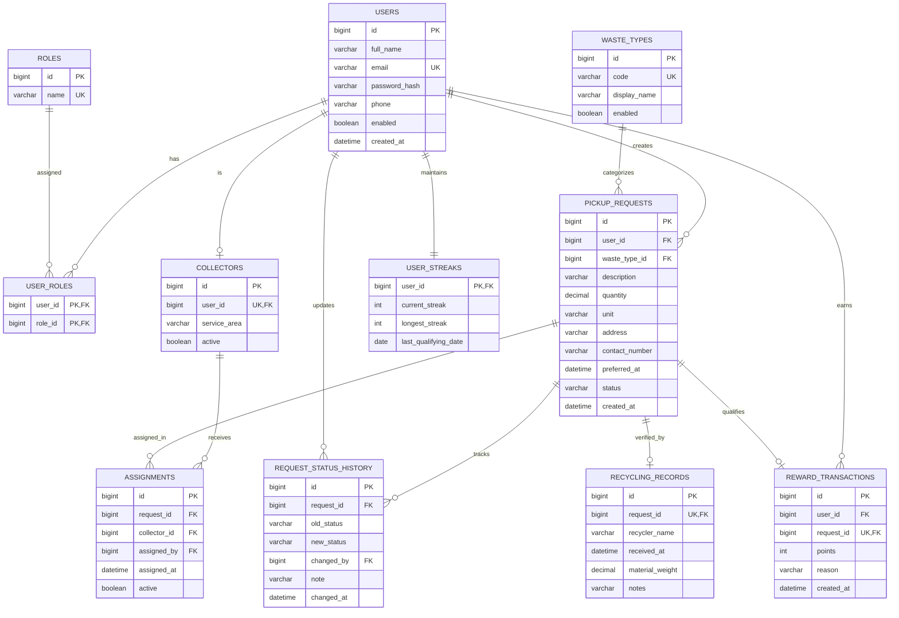

# Eco-Tracker Database Design Specification

This document details the relational database design for **Eco-Tracker**, a smart E-Waste & Dry-Waste Collection Management System built with Spring Boot 3.x and MySQL 8.x / Spring Data JPA.

---

## 1. Entity-Relationship Diagram (ERD)

---

## 2. Table Specifications & Constraints

### 2.1 `users`
Represents application accounts (citizens, collectors, admins).
- `id` (BIGINT, AUTO_INCREMENT, PRIMARY KEY)
- `full_name` (VARCHAR(100), NOT NULL)
- `email` (VARCHAR(100), NOT NULL, UNIQUE, normalized lowercase)
- `password_hash` (VARCHAR(255), NOT NULL, BCrypt encrypted)
- `phone` (VARCHAR(20), NULL)
- `enabled` (BOOLEAN, NOT NULL DEFAULT TRUE)
- `created_at` (DATETIME, NOT NULL, default CURRENT_TIMESTAMP)

### 2.2 `roles`
System roles: `ROLE_USER`, `ROLE_ADMIN`, `ROLE_COLLECTOR`.
- `id` (BIGINT, AUTO_INCREMENT, PRIMARY KEY)
- `name` (VARCHAR(50), NOT NULL, UNIQUE)

### 2.3 `user_roles`
Composite join table enforcing many-to-many relationship between users and roles.
- `user_id` (BIGINT, FK to `users.id` ON DELETE CASCADE)
- `role_id` (BIGINT, FK to `roles.id` ON DELETE CASCADE)
- PRIMARY KEY (`user_id`, `role_id`)

### 2.4 `waste_types`
Accepted waste streams (`E_WASTE`, `DRY_WASTE`).
- `id` (BIGINT, AUTO_INCREMENT, PRIMARY KEY)
- `code` (VARCHAR(50), NOT NULL, UNIQUE)
- `display_name` (VARCHAR(100), NOT NULL)
- `enabled` (BOOLEAN, NOT NULL DEFAULT TRUE)

### 2.5 `collectors`
Field collector profile linked to a user account.
- `id` (BIGINT, AUTO_INCREMENT, PRIMARY KEY)
- `user_id` (BIGINT, NOT NULL, UNIQUE, FK to `users.id` ON DELETE CASCADE)
- `service_area` (VARCHAR(100), NOT NULL)
- `active` (BOOLEAN, NOT NULL DEFAULT TRUE)

### 2.6 `pickup_requests`
Core transaction entity representing citizen waste collection bookings.
- `id` (BIGINT, AUTO_INCREMENT, PRIMARY KEY)
- `user_id` (BIGINT, NOT NULL, FK to `users.id`)
- `waste_type_id` (BIGINT, NOT NULL, FK to `waste_types.id`)
- `description` (VARCHAR(500), NOT NULL)
- `quantity` (DECIMAL(10, 2), NOT NULL, positive)
- `unit` (VARCHAR(20), NOT NULL DEFAULT 'kg')
- `address` (VARCHAR(255), NOT NULL)
- `contact_number` (VARCHAR(20), NULL)
- `preferred_at` (DATETIME, NOT NULL, future service hours 08:00 - 19:00)
- `status` (VARCHAR(30), NOT NULL DEFAULT 'PENDING')
- `created_at` (DATETIME, NOT NULL, default CURRENT_TIMESTAMP)
- **Indexes:**
  - `idx_pickup_requests_user_created (user_id, created_at)`
  - `idx_pickup_requests_status_preferred (status, preferred_at)`

### 2.7 `assignments`
Collector dispatch records.
- `id` (BIGINT, AUTO_INCREMENT, PRIMARY KEY)
- `request_id` (BIGINT, NOT NULL, FK to `pickup_requests.id` ON DELETE CASCADE)
- `collector_id` (BIGINT, NOT NULL, FK to `collectors.id`)
- `assigned_by` (BIGINT, NOT NULL, FK to `users.id` representing admin)
- `assigned_at` (DATETIME, NOT NULL, default CURRENT_TIMESTAMP)
- `active` (BOOLEAN, NOT NULL DEFAULT TRUE)
- **Indexes:**
  - `idx_assignments_collector_active (collector_id, active)`

### 2.8 `request_status_history`
Full audit trail of all status transitions with actor and timestamp.
- `id` (BIGINT, AUTO_INCREMENT, PRIMARY KEY)
- `request_id` (BIGINT, NOT NULL, FK to `pickup_requests.id` ON DELETE CASCADE)
- `old_status` (VARCHAR(30), NULL)
- `new_status` (VARCHAR(30), NOT NULL)
- `changed_by` (BIGINT, NULL, FK to `users.id` ON DELETE SET NULL)
- `note` (VARCHAR(500), NULL)
- `changed_at` (DATETIME, NOT NULL, default CURRENT_TIMESTAMP)
- **Indexes:**
  - `idx_status_history_request (request_id, changed_at)`

### 2.9 `recycling_records`
Official outcome certificate generated once processed at authorized facility.
- `id` (BIGINT, AUTO_INCREMENT, PRIMARY KEY)
- `request_id` (BIGINT, NOT NULL, UNIQUE, FK to `pickup_requests.id` ON DELETE CASCADE)
- `recycler_name` (VARCHAR(150), NOT NULL)
- `received_at` (DATETIME, NOT NULL, default CURRENT_TIMESTAMP)
- `material_weight` (DECIMAL(10, 2), NOT NULL)
- `notes` (VARCHAR(500), NULL)

### 2.10 `reward_transactions`
Idempotent points ledger credited upon completed collection.
- `id` (BIGINT, AUTO_INCREMENT, PRIMARY KEY)
- `user_id` (BIGINT, NOT NULL, FK to `users.id` ON DELETE CASCADE)
- `request_id` (BIGINT, NOT NULL, UNIQUE, FK to `pickup_requests.id` ON DELETE CASCADE)
- `points` (INT, NOT NULL)
- `reason` (VARCHAR(255), NOT NULL)
- `created_at` (DATETIME, NOT NULL, default CURRENT_TIMESTAMP)
- **Indexes:**
  - `uk_reward_transactions_request (request_id)` (Unique constraint enforcing idempotency)
  - `idx_reward_user_created (user_id, created_at)`

### 2.11 `user_streaks`
Tracks consecutive days of recycling activity for bonus points and gamification.
- `user_id` (BIGINT, PRIMARY KEY, FK to `users.id` ON DELETE CASCADE)
- `current_streak` (INT, NOT NULL DEFAULT 0)
- `longest_streak` (INT, NOT NULL DEFAULT 0)
- `last_qualifying_date` (DATE, NULL)

---

## 3. Key Design Considerations

1. **Idempotency & Data Integrity:**
   `reward_transactions.request_id` is constrained `UNIQUE`. Even if a user refreshes the page or triggers repeated requests, at most one reward transaction can ever be created for a single request.
2. **Financial/Weight Precision:**
   `DECIMAL(10, 2)` is strictly used for quantities and weights rather than floating-point numbers (`FLOAT` / `DOUBLE`) to prevent rounding errors.
3. **Auditability:**
   Every lifecycle transition (`PENDING` -> `APPROVED` -> `ASSIGNED` -> `PICKED_UP` -> `COMPLETED`) creates an immutable row in `request_status_history` logging the acting user, previous state, new state, timestamp, and optional remarks.
4. **Normalized Emails:**
   Emails are trimmed and converted to lowercase before persistence and lookups to eliminate duplicate account vulnerabilities.
